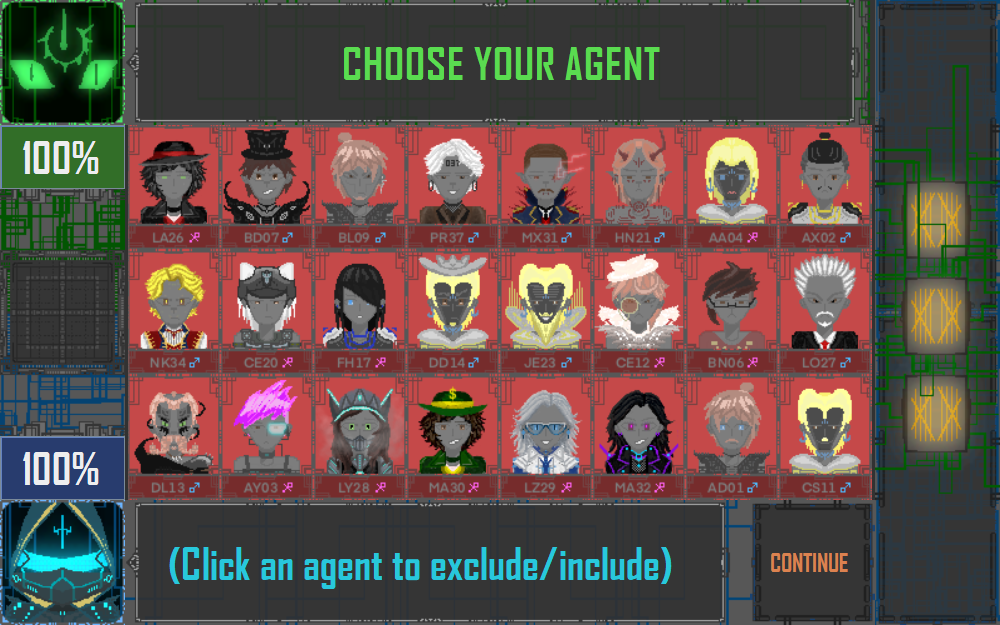
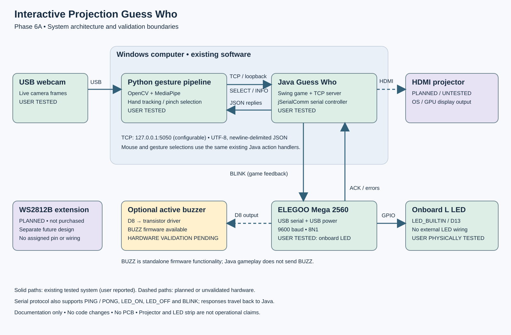
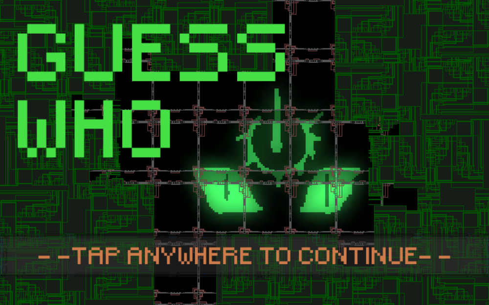
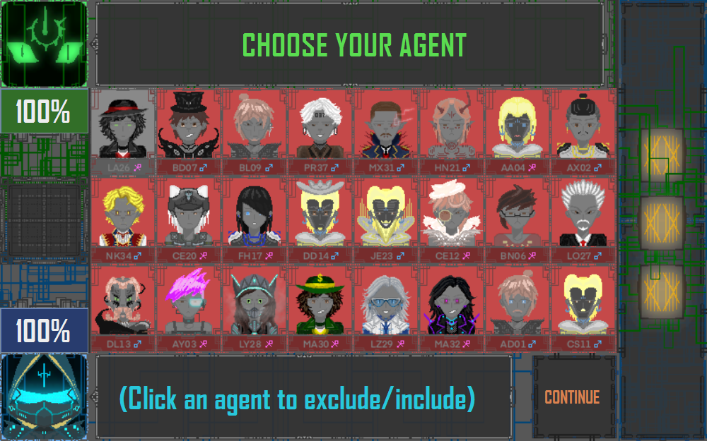
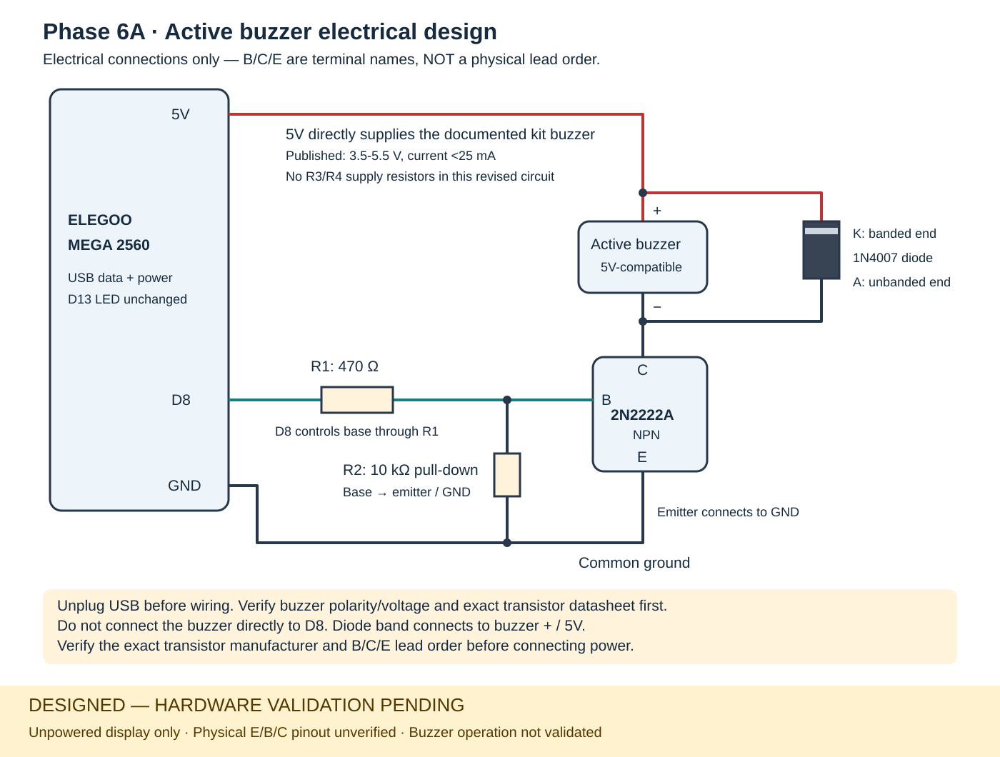
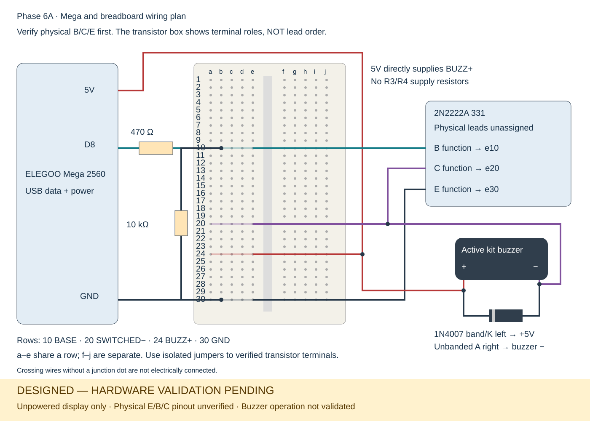

# Interactive Projection Guess Who

### Computer vision meets desktop gameplay and physical feedback.

A working gesture-controlled Guess Who prototype that connects **Python hand tracking**, a **Java Swing game**, and an **Arduino Mega 2560**. Players move an index finger through a calibrated interaction region and pinch to select game controls. The same game actions remain available through the mouse, and eligible character-card changes trigger the Arduino's onboard LED.

The project brings together real-time vision, geometric calibration, networked input, responsive desktop UI and embedded serial control. Its current demonstration runs on a laptop; projector-ready presentation support and engineering drawings prepare it for a future projected tabletop experience.



**Python 3.12 · OpenCV · MediaPipe · Java 17 / Swing · TCP / JSON · Arduino Mega 2560**

[Quick start](#quick-start-windows) · [Demo](#run-a-demo) · [Architecture](#system-architecture) · [Engineering documentation](docs/README.md) · [Test evidence](docs/testing.md)

## Key features

- **Gesture-controlled gameplay:** MediaPipe hand landmarks and OpenCV processing track the index fingertip; a debounced pinch/release state machine generates deliberate selections.
- **Four-point homography calibration:** a camera-space quadrilateral maps into a logical game viewport, with saved calibration and compatibility checks.
- **Live Python → Java control:** newline-delimited JSON over localhost TCP carries selection coordinates and returns execution acknowledgements.
- **One gameplay path:** gesture input activates the real Swing buttons and their existing listeners, preserving mouse controls, rules, artwork and sound.
- **Physical LED feedback:** Java uses jSerialComm to drive the Mega's built-in LED after eligible card actions, with background serial handling and graceful disconnect behavior.
- **Resizable presentation mode:** panel bounds, artwork and text scale with the game window, while input mapping uses the current client-area dimensions.
- **Hardware-independent verification:** synthetic vision/calibration tests, real Java TCP tests, Swing interaction tests and fake-Arduino regressions support repeatable development.

## System architecture



| Layer | Technology | Responsibility |
| --- | --- | --- |
| Vision | Python 3.12, OpenCV-contrib 4.11.0.86, MediaPipe 0.10.21 | Camera capture, landmarks, fingertip tracking and gesture detection |
| Geometry | NumPy 1.26.4, OpenCV homography | Camera-to-viewport coordinate transformation |
| Input transport | TCP, UTF-8 newline-delimited JSON | Local selection requests, INFO queries and acknowledgements |
| Game | Java 17, Swing/AWT | Gameplay, card controls, presentation and mouse interaction |
| Hardware bridge | jSerialComm 2.11.4, USB serial at 9600 baud / 8N1 | Asynchronous commands and responses |
| Controller | ELEGOO Mega 2560, Arduino C++ | Built-in LED feedback and standalone serial commands |

### How the system works

1. The camera supplies frames to OpenCV; MediaPipe estimates a hand's landmarks.
2. The fingertip position is mapped through the calibrated homography. Pinch hysteresis, debounce and cooldown distinguish selections from normal hand movement.
3. Python sends a `SELECT` request containing logical viewport coordinates and an event ID to Java's loopback TCP server.
4. Java maps the point into its current content area, finds an eligible visible button and executes its existing action on the Swing event-dispatch thread.
5. A completed character-card change queues LED feedback. A serial worker sends `BLINK`; the Mega flashes its onboard LED three times and acknowledges completion.

The serial work does not block the UI. A missing board leaves the game playable, and unavailable calibration prevents gesture selections from being sent.

## Actual application views

| Title screen | Card selection |
| --- | --- |
|  |  |

These are captures of the real Java Swing application's rendered content at 1000×625, taken through its normal title and card actions. They are not mockups, photographs of projection, or a recorded gesture demonstration. [Capture details](docs/images/screenshots/README.md).

## Quick start (Windows)

### 1. Prerequisites

- **JDK 17**, with `java` and `javac` available in PowerShell.
- **64-bit Python 3.12**, accessible through `py -3.12`.
- A built-in webcam for gesture practice; an Arduino is optional for running the game.

Download/extract or clone this repository, then open PowerShell **inside the repository root**. Keep that working directory when running Java: the original game loads PNG/WAV assets from the root.

```powershell
java -version
javac -version
py -3.12 --version
```

### 2. Set up vision

```powershell
py -3.12 -m venv computer-vision\.venv
.\computer-vision\.venv\Scripts\python.exe -m pip install -r computer-vision\requirements.txt
.\computer-vision\.venv\Scripts\python.exe -m pip check
.\computer-vision\.venv\Scripts\python.exe .\computer-vision\main.py --download-model
```

The model download is an explicit setup step; subsequent tracking uses the local model. The environment, model and camera-specific calibration files are excluded from Git. Use the pinned OpenCV-contrib distribution rather than installing a second package that also provides `cv2`.

### 3. Build and launch the game

```powershell
.\build-phase7a.ps1
java -cp 'build-phase5b2;arduino\java\lib\jSerialComm-2.11.4.jar' groupDGuessWho.Main --presentation --window-width 1000 --window-height 625 --viewport-fit stretch
```

The build uses `javac`, not Maven or Gradle. It downloads and verifies the pinned jSerialComm JAR when needed. The existing output directory is named `build-phase5b2`; the Phase 7A launcher intentionally reuses it. If Windows blocks the local build script, use `powershell -NoProfile -ExecutionPolicy Bypass -File .\build-phase7a.ps1` for that invocation only.

### 4. Connect gestures

Leave Java running. In a second PowerShell terminal at the same repository root:

```powershell
.\computer-vision\.venv\Scripts\python.exe .\computer-vision\main.py --camera 0 --width 640 --height 480 --connect-java --calibrate --calibration-file .\computer-vision\calibration-laptop-practice.json --viewport-width 1280 --viewport-height 720 --java-fit stretch
```

In the camera preview, click four corners in **top-left → top-right → bottom-right → bottom-left** order. For a laptop-facing webcam, choose a reachable rectangle in the image as a virtual input surface; the camera does not need to see the laptop screen. Open your fingers to arm detection, position the fingertip, then pinch and release. Press **S** to save calibration or **C** to recalibrate; **Q** exits the tracker.

Follow the [projector-ready setup guide](docs/phase7a-projector-ready.md) for camera selection, alignment checks, Windows Extend mode and recalibration after physically moving a projected image.

## Run a demo

1. **Show the game:** use the mouse to advance through the introduction and display the 24-character board.
2. **Show calibration:** move a fingertip around the calibrated rectangle and compare its mapped position with the simulated viewport cursor.
3. **Show interaction:** pinch to exclude or restore a card, then use the mouse on another card to demonstrate that both input methods share the same game logic.
4. **Show presentation scaling:** stop gesture input, resize or maximize the game, then verify alignment before continuing.
5. **Optionally show physical feedback:** connect a Mega with the supplied sketch, close Arduino Serial Monitor, and launch Java with `--arduino-port COM5` appended. Replace COM5 with the detected port. Eligible card actions should trigger the onboard LED.

The developer has physically verified gesture-controlled gameplay and onboard LED feedback. The buzzer design and planned projector/LED-strip extensions have their own verification records in the [hardware documentation](docs/hardware-validation-status.md).

For a software-only demonstration, leave off `--arduino-port`. No external webcam, projector, buzzer wiring or LED strip is required.

## Hardware engineering

The Mega connects to the laptop over USB. The tested feedback path uses **LED_BUILTIN / D13 on the board**, so it needs no external LED wiring. The electrical package also preserves the D8 active-buzzer driver design, its functional transistor terminals, resistor values and diode polarity.

| Electrical design | Breadboard connection plan |
| --- | --- |
|  |  |

[Bill of materials](docs/hardware-bom.md) · [Pin connections](docs/pin-connections.md) · [Editable KiCad schematic](hardware/kicad/README.md) · [Hardware validation](docs/hardware-validation-status.md) · [Concept CAD](hardware/concept-cad/README.md)

## Engineering challenges and solutions

| Challenge | Implementation |
| --- | --- |
| Camera and game use different coordinate spaces | Four-corner homography maps camera pixels into a logical viewport; Java then maps into the current content area. |
| A pinch spans multiple frames | Separate activation/release thresholds, debounce, rearming and cooldown prevent repeated actions from a held pinch. |
| Network input must respect Swing threading | The control server validates requests, then dispatches existing button actions on the EDT. |
| A delivered message is not necessarily an executed action | Explicit ACKs report execution, rejection or no control; event IDs suppress duplicate requests. |
| Serial reset and slow LED sequences can stall an interface | Connection readiness and a bounded background feedback worker keep serial operations away from the EDT. |
| Resizing must preserve mouse and gesture behavior | The presentation adapter scales actual controls and artwork; hit testing reads the live Swing hierarchy. |
| Hardware and software have different evidence levels | Repeatable tests and dedicated validation records distinguish implemented logic, physically demonstrated integration and future designs. |

## Tests

```powershell
.\build-phase7a.ps1 -Test
Push-Location computer-vision
.\.venv\Scripts\python.exe -m unittest discover -s tests -v
Pop-Location
$env:JAVA_TEST_CLASSPATH = 'build-phase5b2;arduino\java\lib\jSerialComm-2.11.4.jar'
.\computer-vision\.venv\Scripts\python.exe -m unittest discover -s tests -v
```

Recorded verification includes **73 Python vision/calibration tests**, **16 Python-to-Java protocol tests**, **32 presentation checks**, and serial/game-feedback regressions. These are test counts, not performance benchmarks. See [test evidence and scope](docs/testing.md) for the runs, expected environment and hardware boundaries.

## Project structure

```text
src/groupDGuessWho/       Java game, TCP adapter and presentation support
computer-vision/         Tracking, pinch detection, calibration and live client
arduino/serial_test/     Mega firmware
arduino/java/            Serial controller, standalone utility and tests
tests/                  Java/Swing and Python TCP integration tests
docs/                   Setup guides, screenshots and engineering records
hardware/kicad/         Editable electrical schematic and connectivity reference
hardware/concept-cad/   Documentation-only spatial concept
java_protocol.py        Shared Python TCP transport
test_java_connection.py Manual Java connection utility
build-phase7a.ps1       Current build/test entry point
*.png, *.wav            Original game artwork and audio (runtime paths preserved)
```

## Documentation and credits

Start with the [documentation index](docs/README.md), [validation evidence](docs/testing.md) or [GitHub publishing guide](docs/publishing.md).

This integration builds on the existing Java Guess Who game, whose source credits **James Chen, Edward Li, Aden Wu and Lucas Chua**. Original gameplay and asset paths are preserved. [Credits and dependency provenance](docs/credits.md).
