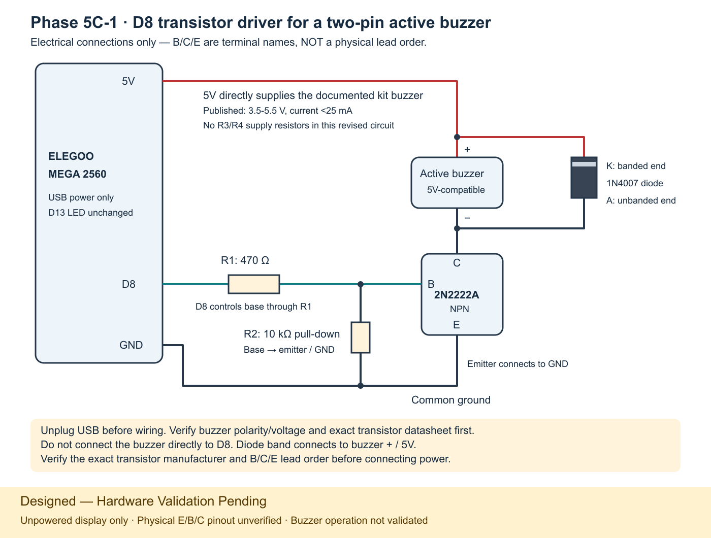
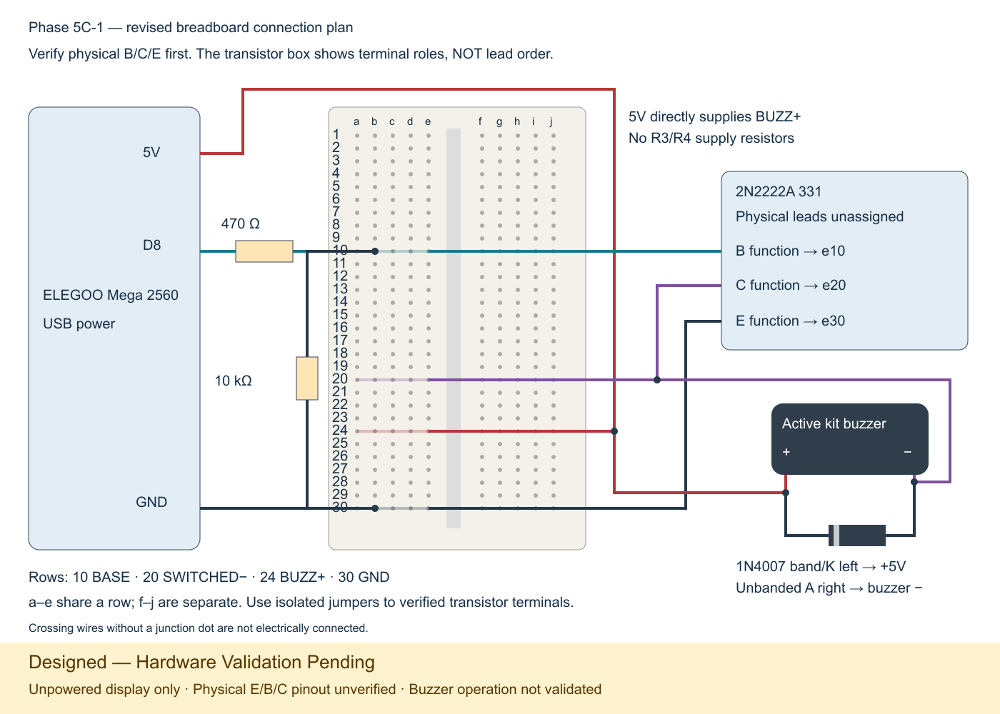

# Phase 5C-1 — active buzzer over USB serial

**Status: Designed — Hardware Validation Pending**

The retained design is a PN2222/2N2222A-family NPN transistor driver with a 470 Ω base resistor, 10 kΩ pull-down, 1N4007 protection diode, and two-pin active buzzer. The available transistor is marked **2N2222A 331**; its exact physical E/B/C pinout is **unverified**. All diagram terminals describe electrical functions only, with no physical pin numbers or lead order assigned.

The physical buzzer circuit has **not been validated or demonstrated working**. Prior firmware compilation and hardware-free tests do not establish electrical operation. Hardware investigation is deferred; the ULN2003 option is not the selected design.

For GitHub or an exhibition, display the circuit **unpowered**, with USB and every other supply disconnected. Suggested caption: “Phase 5C-1 active buzzer driver — Designed — Hardware Validation Pending. E/B/C are functional labels; physical transistor pinout and audible operation remain unverified.” Documentation is finalized at this scope; hardware validation is not complete.

The Mega sketch now accepts **BUZZ**, switches **D8 HIGH for 180 ms**, and returns **ACK BUZZ immediately on acceptance**. It then turns D8 LOW without another response. This phase does not add BUZZ to Java or connect it to game events. Existing Java feedback still sends only BLINK.

## Files

- Modified: `arduino/serial_test/serial_test.ino`.
- Added: this guide, `docs/images/phase5c1-buzzer-wiring.svg`, `docs/images/phase5c1-breadboard.svg`, and their PNG previews.
- Added hardware-free tests: `arduino/tests/phase5c1/Arduino.h`, `test_sketch.cpp`, `run-simulation.cjs`, and `run-tests.ps1`.
- Test record: `docs/phase5c1-test-results.txt`.

No Java, Python/OpenCV, images/sounds used by the game, or Phase 5B-2 configuration was changed. Test headers are outside the sketch directory and are not part of the uploaded firmware.

## Official kit datasheet review — updated circuit decision

Your reading of Lesson 6 is correct: ELEGOO's introductory wiring uses the active buzzer directly on a digital output and GND, without a transistor. The linked [Lesson 6](https://www.manualslib.com/manual/4058976/Elegoo-Mega-2560.html?page=61) lists only the board, buzzer, and two wires. Its wiring illustration in the previously inspected ELEGOO PDF uses D12; D8 is also a 5 V digital output, but changing the pin does not reduce load current.

I downloaded the archive linked by [ELEGOO's official Mega kit tutorial page](https://www.elegoo.com/blogs/arduino-projects/elegoo-mega-2560-the-most-complete-starter-kit-tutorial): `ELEGOO The Most Complete Starter Kit for MEGA V1.0.2023.05.05.zip`. It contains `##Datasheet/Lesson 6 Active buzzer.pdf`. [Read the extracted original datasheet](phase5c1-elegoo-active-buzzer-datasheet.pdf).

| Published kit-buzzer specification | Value |
| --- | --- |
| Type | Active electromagnetic buzzer |
| Nominal voltage | 5 V |
| Operating voltage | 3.5–5.5 V |
| Current | Less than 25 mA |
| Frequency | 2300 ± 500 Hz |

**Direct D8 drive is not verified to meet the requested 20 mA limit.** Less than 25 mA is not a guarantee of at most 20 mA; the sheet does not specify startup peak current or identify a manufacturer/part number. It describes the supplied kit component, not a measurement of your particular unit. Confirm with ELEGOO if your kit revision/part differs. I am not claiming that every specimen draws more than 20 mA, only that this specification cannot justify the requested guarantee. The tutorial and the current bound therefore do not establish the same thing.

**Decision: keep a transistor driver, but simplify it.** Remove the earlier two 220 Ω parallel supply resistors from the proposed design for this documented 5 V kit buzzer. Their 110 Ω resistance could drop 2.2 V at 20 mA, leaving under 3 V after the transistor—below the published 3.5 V minimum. They were a provisional current-limiting choice while the rating was unknown, not a suitable final supply arrangement for the documented part. Connect buzzer + to Mega 5V instead. Keep the 470 Ω base resistor, 10 kΩ pull-down, and 1N4007 flyback diode. Use this revised diagram, not earlier saved images.

For direct drive to become a supported alternative, obtain manufacturer/ELEGOO confirmation for the exact supplied part that its worst-case running and startup current at the Mega's output voltage stays within 20 mA, with appropriate margin and any required inductive-transient protection. A multimeter's average reading alone cannot establish startup peaks or production limits. Do not test an unknown load directly on D8 to find out.

## Identification update: 2N2222A 331

You confirmed the two-pin active buzzer and a TO-92 transistor marked **2N2222A 331**. This supersedes the earlier assumption that the transistor was marked PN2222.

**Pinout status: NOT VERIFIED.** I could not match that complete marking to an authoritative manufacturer marking table. Do not interpret `331` as a pin-order code, and do not substitute a PN2222/P2N2222A datasheet as proof of this part's lead order. The schematic below remains an electrical design; physical transistor leads are deliberately unassigned.

Physical lead identification and powered testing are deferred. Do not energize this display circuit until the exact transistor's terminal order and component suitability have been verified. No further identification work or component purchase is requested for this documentation milestone.

The breadboard plan shows electrical nodes, not a verified transistor footprint. Future assembly and test procedures below are retained as a validation plan, not as completed work or instructions to power the current unverified assembly.

## Hardware verification and source references

I inspected ELEGOO's **Lesson 6 — Active buzzer**, including its wiring illustration (pages 64–67 of the 223-page edition). It depicts the buzzer on D12 and GND. This project instead uses D8 through a transistor. ELEGOO describes its active part as having a sealed/black underside, versus the passive part's exposed green board; these are kit-identification clues, not universal specifications. An active buzzer contains its own oscillator and sounds from DC power. [Official ELEGOO tutorial download page](https://www.elegoo.com/blogs/arduino-projects/elegoo-mega-2560-the-most-complete-starter-kit-tutorial); [ELEGOO-authored PDF edition inspected](https://images-na.ssl-images-amazon.com/images/I/D1oC-c3G5TS.pdf).

**The lesson alone does not supply current ratings; the separate official archive datasheet now provides the kit-buzzer ratings above. Its less-than-25-mA bound does not establish compliance with a 20-mA GPIO limit.** Arduino specifies 20 mA per Mega I/O pin as the recommended operating condition; 40 mA is an absolute limit, not a design target. [Arduino Mega specifications](https://store.arduino.cc/products/arduino-mega-2560-rev3).

Use the transistor circuit below. Because the exact buzzer markings and transistor manufacturer have not been supplied, the electrical connections are specified by **verified terminal names**, not an assumed left/middle/right lead order. Confirm that the buzzer's rated operating range includes 5 V and identify its polarity before powering it. If its markings cannot establish those facts, obtain its datasheet or confirmation from ELEGOO; a transistor does not make an unknown-voltage part safe at 5 V.

### Identify the parts before wiring

1. Select the **two-pin active buzzer** from the kit, not a passive buzzer or a three-pin module. Compare the underside with Lesson 6. A passive buzzer may merely click on DC and needs a waveform; this firmware intentionally does not use `tone()`.
2. Find the buzzer's **+** mark on its body/top or datasheet and trace it to the corresponding lead. On many uncut parts the longer lead is positive, but clipped leads and different packages make length alone unreliable. The other lead is negative. Do not guess polarity from the sound-hole sticker alone.
3. Read the transistor's full marking and manufacturer logo. Match the exact datasheet's package view and identify **B (base), C (collector), E (emitter)**. A multimeter's diode test can help locate a base, but does not reliably identify collector versus emitter by itself.
4. Similar transistor names do not establish interchangeable physical pinouts. No numbered transistor pins are assigned in this design.

## Circuit and parts



[Open scalable schematic SVG](images/phase5c1-buzzer-wiring.svg).



[Open breadboard SVG](images/phase5c1-breadboard.svg). This is a connection plan, not a verified transistor footprint. Use isolated jumpers from the identified transistor terminals to the labeled breadboard rows. The three physical transistor legs remain unassigned until identification is complete. Rows 10, 20, 24, and 30 below are example rows on a standard breadboard with a–e and f–j contact groups; check your board's actual connectivity first.

| Breadboard node | Example holes | Connect here |
| --- | --- | --- |
| BASE | a10–e10 | R1 output, R2 top, verified B via jumper |
| SWITCHED− | a20–e20 | Buzzer −, diode unbanded A, verified C via jumper |
| BUZZ+ | a24–e24 | Mega 5V jumper, buzzer +, diode banded K |
| GND | a30–e30 | Mega GND, R2 bottom, verified E via jumper |

Each listed row's five holes are connected together. Different row numbers are separate. The opposite f–j group across the center gap is not connected unless you add a jumper. Do not force the transistor directly into these widely separated rows; use insulated connections after verifying the terminals.

Use:

- One verified 5 V-compatible two-pin active buzzer and your TO-92 transistor marked **2N2222A 331**, after verifying its manufacturer, ratings, and terminal order.
- **R1 = 470 Ω**, at least ¼ W, between D8 and base.
- **R2 = 10 kΩ**, at least ¼ W, between base and emitter/GND. It keeps the transistor off while reset/bootloader leaves D8 as an input.
- No buzzer supply resistor: the documented 5 V kit buzzer receives Mega 5V through the transistor switch. The earlier R3/R4 proposal is superseded.
- **One 1N4007 diode** across the buzzer: cathode/banded end to buzzer +, anode/unbanded end to buzzer −. Verify that you have this extra part; it was not in your enumerated hardware list. Obtain one if absent. The band denotes the cathode. [Vishay datasheet](https://www.vishay.com/docs/88503/1n4001.pdf).
- Breadboard and jumper wires. No breadboard power module or external supply is needed; use USB power only.

The transistor carries the documented buzzer load (less than 25 mA); D8 supplies only base drive. At an illustrative 0.8 V base-emitter drop, R1 draws `(5 - 0.8) / 470 ≈ 8.9 mA`, below 20 mA. R2 draws about 0.08 mA when on. Verify the exact transistor's ratings and saturation characteristics as well as its pinout. This arrangement avoids making the GPIO carry the buzzer load and avoids the large voltage drop of the earlier supply resistors.

The diode provides a path for load inductive transients on turn-off if the buzzer is magnetic. Its **band must face the positive buzzer terminal**. It is connected across the buzzer, not in series and not across the transistor's base/emitter.

### Exact connection table

Name four separate breadboard nodes: **+5V**, **GND**, **BASE**, and **BUZZ+**; the collector/buzzer-negative connection is a fifth node **SWITCHED−**. Names describe electrical connections, not breadboard row numbers.

| From | To | Notes |
| --- | --- | --- |
| Mega **5V** | +5V rail/node | USB-supplied 5 V; do not use VIN or 3.3V |
| Mega **GND** | GND rail/node | Common ground |
| Mega **D8** | R1 first lead | Do not connect D8 directly to buzzer |
| R1 second lead | BASE node / transistor **B** | R1 is 470 Ω |
| R2 first lead | BASE node / transistor **B** | R2 is 10 kΩ |
| R2 second lead | GND / transistor **E** | Pull-down |
| Transistor **E** | GND | Confirm exact part's lead order first |
| Mega 5V / +5V | BUZZ+ | Direct supply jumper; no R3/R4 |
| Buzzer **+** | BUZZ+ | Directly supplied from Mega 5V |
| Buzzer **−** | SWITCHED− / transistor **C** | Not directly to GND |
| Diode **K**, banded end | BUZZ+ / buzzer **+** | Correct polarity is essential |
| Diode **A**, unbanded end | SWITCHED− / buzzer **−** / transistor **C** | Across buzzer |

### Future validation: step-by-step assembly

1. Close the Java game, standalone serial tester, and Serial Monitor. Unplug USB and any other power before moving wires.
2. Verify the component identities, 5 V compatibility, buzzer +/−, and transistor B/C/E as above. If unclear, stop before applying power; the diagram intentionally does not guess physical lead order.
3. Put the transistor's three legs in **three separate breadboard contact strips**. Do not place them in holes that are internally connected. Put the buzzer leads in separate strips too.
4. Connect Mega GND to a ground rail and transistor E to that rail. Breadboard rails may be split in the middle; use one continuous section or bridge the sections you need.
5. Connect D8 through R1 (470 Ω) to B. Connect R2 (10 kΩ) from B to E/GND. These resistors are not polarized.
6. Connect Mega 5V to a separate positive rail. Jumper that rail to BUZZ+, then connect buzzer + to BUZZ+. Do not install the earlier R3/R4 supply resistors.
7. Connect buzzer − to C. Add the diode across the buzzer, with its band at buzzer +. Keep it out of the D8/base connection.
8. Compare each wire against the table and inspect for accidental adjacent-leg shorts or a 5V-to-GND bridge. If you have a multimeter, check continuity with power disconnected. Do not connect an ammeter directly across the supply.
9. Reconnect USB only after those checks. The buzzer should remain quiet at startup. If a component heats, the board resets, or the buzzer runs continuously, unplug USB and check the circuit before continuing.

## Future validation: upload the updated sketch

1. Keep the game and Phase 5B-1 CLI stopped so the Arduino IDE can own the port.
2. Open `arduino/serial_test/serial_test.ino` in Arduino IDE 2.
3. In Boards Manager, use **Arduino AVR Boards** by Arduino.
4. Select **Tools → Board → Arduino AVR Boards → Arduino Mega or Mega 2560**.
5. Select **Tools → Processor → ATmega2560 (Mega 2560)**.
6. Select the board's current port under **Tools → Port** (previously **COM5**). Confirm by comparing Device Manager → Ports before/after reconnecting if needed.
7. Click **Verify**, then **Upload**. This replaces the sketch on the Mega with the backward-compatible extension. No library installation is needed for this sketch.
8. Open **Serial Monitor**, select **9600 baud** and **New Line** (or **Both NL & CR**), and wait two seconds for reset. There is no startup banner. D8 and the built-in LED initialize LOW.

## Future validation: manual serial tests

Send the literal command text without quotes or a typed `\n`. Serial Monitor supplies the line ending. For ordinary testing, send one command at a time and wait for its reply. After BUZZ, additionally wait about 250 ms before sending another BUZZ because its ACK is immediate, not a completion indication.

| Send | Expected response | Expected physical result — unverified |
| --- | --- | --- |
| `PING` | `PONG` | No change |
| `BUZZ` | `ACK BUZZ` immediately | One approximately 180 ms beep, then quiet |
| `LED_ON` | `ACK LED_ON` | Onboard L LED on; buzzer stays quiet |
| `LED_OFF` | `ACK LED_OFF` | L LED off; buzzer stays quiet |
| `BLINK` | `ACK BLINK` after completion | Three flashes, ends off; initial 250 ms off + three 250 ms on/off cycles, about 1.75 s |
| `HELLO` | `ERR UNKNOWN_COMMAND` | No new beep or flash |
| `buzz` | `ERR UNKNOWN_COMMAND` | Commands remain uppercase/exact |
| `ABCDEFGHIJKLMNOPQRSTUVWXYZ123456` | `ERR LINE_TOO_LONG` | No output action; next PING still works |

Perform the following:

1. Send PING, then BUZZ. Hear one short beep; verify it stops by itself.
2. Wait at least 250 ms and send BUZZ again. Repeat with **Both NL & CR** selected; expect one beep per accepted command.
3. Test LED_ON, LED_OFF, and BLINK sequentially with the table. Confirm the familiar ACK BLINK is still delayed until the sequence finishes, not sent on acceptance.
4. During BLINK, send BUZZ. A beep should occur and stop while the LED sequence continues. ACK BUZZ can appear **before** the pending ACK BLINK. PING during either animation should still return PONG.
5. If a second BUZZ reaches the board within the 180 ms interval, expect **ERR BUSY_BUZZ** and no restarted/extended beep. Sending LED_ON, LED_OFF, or another BLINK during an active BLINK returns **ERR BUSY_BLINK**, leaving the current three-flash sequence intact.
6. Send HELLO, lowercase buzz, an empty line, and the oversized line in the table. Empty lines are ignored. Send PING afterward to check recovery. With **No line ending**, a command waits for LF; restore New Line and reset the board before resuming if a partial line remains pending.
7. Press RESET; the buzzer should be off after reset/startup. The hardware pull-down keeps it off while D8 is high impedance. Remove power before changing wiring.
8. Optional Phase 5B-2 regression: close Serial Monitor, launch the game using your existing Phase 5B-2 commands, and test a card click and pinch. Existing LED feedback should still work. There should be **no buzzer sound** from game actions because Java has not been changed to send BUZZ. Stop the game before opening Serial Monitor again.

## Firmware design and compatibility

BUZZ uses `millis()` rather than `delay()`. Repeated BUZZ during a beep is rejected without restarting the timer. Only ACK BUZZ is emitted for an accepted beep; there is no unsolicited completion message that could confuse a serial client.

BLINK now uses a small nonblocking timer/state machine too. This is necessary because the old blocking delays could otherwise keep D8 HIGH much longer than 180 ms when BLINK follows BUZZ. Normal sequential PING/LED_ON/LED_OFF/BLINK behavior and replies remain unchanged, including the completion-only ACK BLINK used by Java. Newly supported concurrent LED commands are rejected while BLINK owns the LED rather than corrupting its sequence. The existing Java worker already waits for each reply, so it does not encounter this busy case.

Serial parsing retains its 32-byte buffer (31 characters plus terminator), CRLF handling, invalid-character detection, and discard-until-newline behavior. It processes at most 32 bytes per loop and services timers between bytes. Both timing checks use unsigned 32-bit subtraction for rollover. No external Arduino libraries, `tone()`, dynamic `String`, or interrupt changes are introduced. Serial flooding can still create UART backpressure; use normal command rates rather than treating this as a hard-real-time streaming system.

## Tests actually performed

- Inspected ELEGOO's active-buzzer tutorial text and rendered wiring page; checked official Mega GPIO guidance and transistor/diode datasheets.
- Compiled the real sketch with the installed Arduino CLI for **`arduino:avr:mega:cpu=atmega2560`**, Arduino AVR Boards **1.8.8**: **passed**, using **3,478 bytes flash and 265 bytes SRAM**.
- **32 actual-sketch checks passed** in a hardware-free AVR8js test harness. The harness includes the real `.ino`, mocks Arduino serial/pins/time, and compiles for a small emulated AVR CPU. It is a logic test, not a simulated Mega board or an electrical test. Covers 9600 startup, existing replies, BUZZ acceptance, 179/180 ms edges, duplicate rejection/no extension, PING during BUZZ/BLINK, overlapping LED/beep timing, all three blink phases and completion ACK, LED busy handling, overflow recovery, invalid input, partial lines, CRLF, empty lines, and uint32 timer rollover.
- Rendered and visually checked the generated wiring diagram.
- No upload, electrical measurements, audible beep, physical wiring verification, or physical Phase 5B-2 regression was performed. Those remain the manual steps above. The official kit ratings are now documented above; matching them to the physical part and verifying transistor lead order remain hardware checks.

To rerun the tests, install Node.js if it is not on PATH and use the installed AVR compiler (from Arduino AVR Boards). From the project root:

```powershell
.\arduino\tests\phase5c1\run-tests.ps1
```

If necessary, pass `-AvrBin 'path\to\avr-gcc\bin'` and `-Node 'path\to\node.exe'`. The script downloads **avr8js 0.21.0** from npm if absent and verifies SHA-256 `4DCAF64ABFC5A3AD39BB03472810E1AE8914914EDD424623428DCAECA597731D`. It uses `tmp/phase5c1/` for generated test files. There are no runtime dependencies for the Arduino sketch. Test harnesses and the simulator are not uploaded.

Optional compile-only command with this PC's installed CLI:

```powershell
$env:ARDUINO_DIRECTORIES_DATA = 'C:\Users\YOUR-USER\AppData\Local\Arduino15'
& 'C:\Users\YOUR-USER\AppData\Local\Programs\Arduino IDE\resources\app\lib\backend\resources\arduino-cli.exe' compile --fqbn arduino:avr:mega:cpu=atmega2560 --build-path 'tmp\phase5c1\mega-build' arduino\serial_test
```

## Troubleshooting

| Symptom | Check |
| --- | --- |
| ACK BUZZ but no sound | ACK proves command acceptance, not electrical operation. Verify active part, polarity, B/C/E, shared GND, resistor values, and split breadboard rails. Check that the documented kit part is supplied from 5V and that the transistor is correctly identified and switching. The superseded R3/R4 resistors should not be installed. |
| One click rather than a beep | You may have selected the passive buzzer. Compare the kit parts/datasheet; do not modify Java to fix a hardware identification issue. |
| Continuous sound at startup | Disconnect power; check whether buzzer − is accidentally grounded directly, transistor C/E are swapped, or the pull-down/base connection is wrong. |
| Quiet beep | Check supply voltage, transistor pinout/saturation, and the sound-hole cover. Do not substitute a passive buzzer. |
| Board resets or a part heats | Unplug USB immediately and inspect supply shorts, diode direction, transistor lead order, and component voltage/current ratings. |
| No serial response | Confirm correct Mega board/processor/COM port, 9600 baud, and newline ending. Stop Java/other port users. |
| ERR BUSY_BUZZ | Wait until the current beep ends; the command was not accepted or queued. |
| ERR BUSY_BLINK | Wait for ACK BLINK before another LED command. BUZZ and PING can run during BLINK. |
| Java LED feedback fails after testing | Close Serial Monitor before relaunching Java; only one process can own COM5. Confirm PING/BLINK manually with Java stopped. |

Stop at Phase 5C-1. Automatic game sound, LED strips, and other hardware phases are not implemented.
