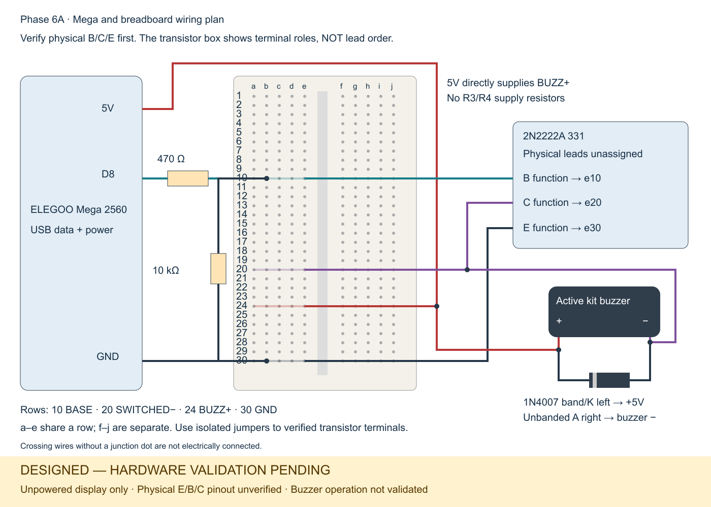

# Pin connections — Phase 6A

**DESIGNED — HARDWARE VALIDATION PENDING.** These are electrical functions, not a physical lead map for the transistor marked `2N2222A 331`. No left/middle/right assignment, numbered package pins or footprint is approved. Display the assembly unpowered, with USB and all other supplies disconnected.

| From | To | Meaning |
| --- | --- | --- |
| Computer USB | Mega USB socket | Existing serial data and USB power; disconnect for display |
| Mega D8 | R1 input | Buzzer-control output; never directly to the buzzer |
| R1 output | Q1 B and R2 top | 470Ω series base drive |
| R2 bottom | Q1 E / Mega GND | 10kΩ pull-down |
| Mega 5V | BZ1 + and D1 K | Positive buzzer supply; diode band identifies K |
| BZ1 − | Q1 C and D1 A | Switched negative node; diode unbanded end identifies A |
| Q1 E | Mega GND | Common return |
| LED_BUILTIN / D13 | Existing onboard L LED | No additional breadboard circuit |

Q1 B = base, C = collector, E = emitter. Pin identifiers in the editable schematic represent these functions only. Buzzer polarity must follow its identified + terminal, not an assumed trimmed-lead length. R1/R2 are not polarized. D1 is across the buzzer, with its band at +5V, not in series.

## Reading the wiring plan

Red is +5V; teal is the D8/base signal; purple is the switched negative node; dark wires are ground/return. Junction dots identify joins; crossings without dots do not connect. Rows 10, 20, 24 and 30 illustrate BASE, SWITCHED−, BUZZ+ and GND respectively. Within a row, a–e connect together; f–j form a separate group. These example breadboard rows do not assign transistor legs. The transistor is deliberately shown as a functional block: do not infer a package orientation from the drawing. The USB label denotes the board's USB connector, not loose wires to a breadboard.

## Interfaces outside the breadboard

USB webcam → Python capture; Python ↔ Java uses newline-delimited UTF-8 JSON over TCP at default 127.0.0.1:5050 (configurable). Java ↔ Mega uses USB serial, 9600 baud, 8 data bits, no parity, 1 stop bit; COM port is configurable (COM5 previously used). Java rendering reaches the planned projector through the computer's graphics/HDMI output.

The existing game sends BLINK for card feedback. BUZZ remains a standalone firmware command: immediate ACK BUZZ, D8 HIGH for 180ms, then LOW. It is not connected to Java game sound events. PING, LED_ON, LED_OFF and BLINK remain unchanged by this documentation phase.

No WS2812B pin is allocated. Its supply, data interface, grounding and protection remain separate future design work.
