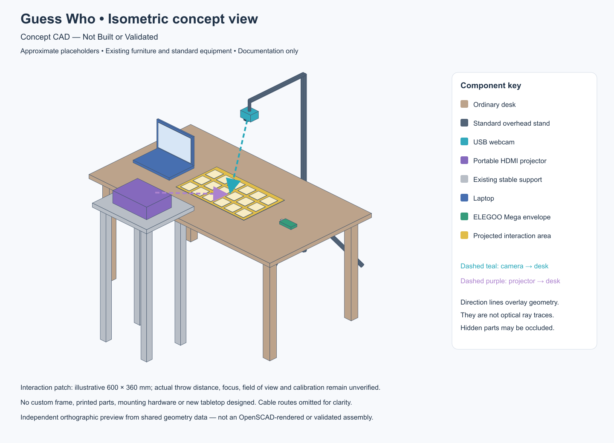

# Concept CAD — Not Built or Validated

Phase 6B is a presentation-only spatial concept for Interactive Projection Guess Who. It shows ordinary existing furniture, a standard overhead webcam stand, a portable projector on a generic stable support, a laptop and an ELEGOO Mega envelope. It is **not** a manufacturing, 3D-printing, assembly or purchasing specification. The geometry does not represent measured/purchased equipment or a tested mounting arrangement.

The gold patch is an illustrative projected interaction area; its tiles suggest Guess Who cards, not the exact GUI. Teal indicates the camera-to-desk direction; purple indicates the projector-to-desk direction. Direction lines overlay geometry and are annotations, not physical rods, calibrated optical axes, field-of-view boundaries or ray tracing. No cables are routed. The laptop would provide USB connections to the webcam/Mega and HDMI to the projector in the real setup.

## Approximate placeholders

All coordinates use illustrative millimetres. X runs across the desk, positive Y toward its rear, and Z upward from the floor.

| Item | Illustrative dimensions / position |
| --- | --- |
| Ordinary existing desk | 1600 × 900 mm; surface 750 mm above floor |
| Interaction patch | 600 × 360 mm, centered on desk |
| Webcam | 90 × 70 × 50 mm envelope; about 500 mm above desktop |
| Standard overhead stand | Mast behind desk; about 1350 mm overall height; generic tripod legs and existing boom |
| Portable projector | 300 × 220 × 90 mm envelope, in front of desk |
| Existing projector support | 480 × 420 mm top; top at 980 mm above floor |
| Laptop | 320 × 220 mm base; simplified open screen, left of interaction patch |
| Mega | 102 × 54 × 18 mm envelope on right; approximate connector marker, no component/PCB detail |

These dimensions are chosen for visual communication, not optical performance or stability. The simple webcam/projector boxes do not model actual lens tilt mechanisms. The direction annotations convey intended viewing/projection toward the desk. Throw distance, focus, keystone correction, field of view, shadows, stand loads, cable reach, clearances and support stability are unverified. No custom aluminum frame, printed part, mechanical bracket or new tabletop is designed.

## View and edit

No FreeCAD or OpenSCAD executable was available on the generation machine. The editable model is therefore supplied as OpenSCAD source; native opening, preview and rendering have **not** been performed.

1. For immediate viewing without CAD software, open `isometric.png`, `front.png`, `side.png` or `top.png`. SVG versions open in a browser and remain sharp when zoomed.
2. With OpenSCAD installed, open `guess-who-concept.scad` through **File → Open** and use **Preview (F5)**, then **View All**. Rotate/zoom or select standard views from the View menu.
3. Edit the model's colored polyhedra directly, or edit the simple `box(...)` / `rod(...)` definitions in `generate-concept.cjs` and run `node generate-concept.cjs` from this folder. Regeneration overwrites the SCAD, scene JSON and SVG files; it does not update PNG files automatically.
4. The SCAD toggles `show_directions` and `show_interaction_tiles` hide the corresponding presentation details. Direction arrows end at the desk.

The SVG/PNG views are **independent orthographic illustrations from the shared geometry data**, not exports from OpenSCAD. Front looks from negative Y, side from positive X, and top from above; isometric is an oblique overview. The preview renderer uses explicit component layering for clarity rather than a CAD hidden-surface engine. Do not use previews for collision/clearance evaluation. In front view, camera and projector direction annotations overlap in projection; the side and isometric views distinguish them.

## Files

- `guess-who-concept.scad` — editable OpenSCAD assembly source, no external libraries.
- `isometric.svg`, `front.svg`, `side.svg`, `top.svg` — scalable presentation views.
- `isometric.png`, `front.png`, `side.png`, `top.png` — raster GitHub previews.
- `scene-reference.json` — shared approximate geometry and direction endpoints.
- `generate-concept.cjs` — standalone Node.js documentation generator (no game integration).
- `README.md` — scope, dimensions, limitations and viewing instructions.

All four PNG views were opened for visual inspection. A first-pass isometric occlusion issue was corrected before finalizing. Native CAD parsing/rendering, physical mounting, projection, manufacturing and structural validation were not performed. There are no STL, fabrication drawings or PCB files.

This folder is separate from the tested software/electrical systems and Phase 6A documentation. No Java, Python, Arduino firmware or Phase 6A document was modified. The unvalidated buzzer circuit and future WS2812B extension are outside this simplified spatial concept. Stop at Phase 6B.
